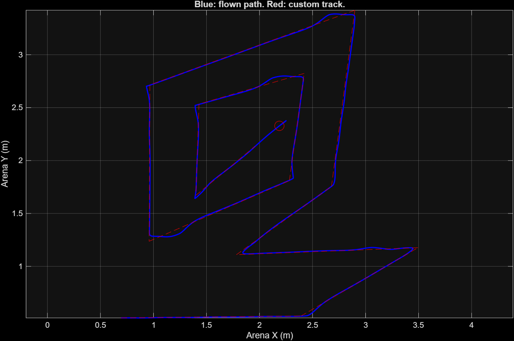

# Simulation screenshot

Saved from the project's custom-run output on 31 October 2026 at 15:25 local time. Blue is the flown path; red is the custom reference track and circular marker. This is a saved simulation trajectory, not a hardware-flight photograph or video. The image alone does not establish exact tracking, touchdown accuracy or all-track reliability.

The project owner reports the edge-clipping issue fixed with Antigravity. The screenshot is provided as visual project media, without claiming an independently verified link between the recording and every file in the portable archive.
