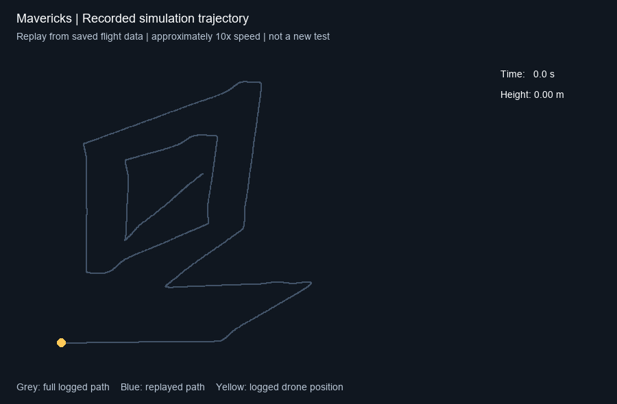

# Logged simulation replay

Animation of the existing custom-run trajectory.csv, showing logged position and altitude through 228.5 simulated seconds at approximately 10x playback. Grey is the complete logged path, blue is progress, yellow is the drone position. NED states are converted to arena coordinates with X+0.5 and Y+1; height=-Z.

This is a data replay, not a new simulation, camera recording, or hardware flight. It does not show the camera input or prove performance on all tracks. The reference red stripe is not drawn in this animation; see the separate saved trajectory screenshot for the reference overlay. No timing or positions were fabricated.
